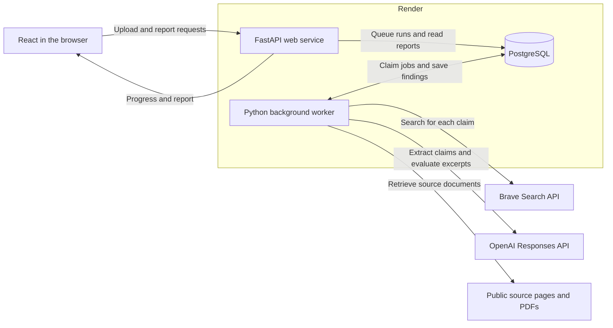

# Fact-Checking Web App Architecture

## System Overview

The app accepts a PDF and produces a report with one entry per factual claim. A React frontend handles upload, progress, and results. A FastAPI backend accepts the file and serves the report. A separate Python worker extracts claims, searches the live web, and checks the evidence. PostgreSQL stores pending work and report data so an upload can continue processing after the browser closes or a service restarts.

## Components

| Component | Responsibility |
| --- | --- |
| **React frontend** | Collect one PDF per run. Show upload errors, processing progress, and the report in document order. Each result shows the original wording, page, verdict, explanation, correction when available, and source links. |
| **FastAPI backend** | Serve the built frontend and API on the same origin. Check upload size and file type, create a run, and authorize access to its progress and results. Return once the job and file are durably stored. [FastAPI file uploads](https://fastapi.tiangolo.com/tutorial/request-files/) |
| **Python worker** | Parse the PDF, extract and validate claims, search for evidence, apply the verdict rules, and write progress and findings. PDF parsing runs with resource and time limits. |
| **PostgreSQL** | Keep the job queue, temporary PDF bytes, claims, evidence, and report results in one datastore. Transactions keep the queue and its data in sync. |
| **Brave Search API** | Run live searches and return candidate source URLs. The worker fetches relevant pages and uses their contents as evidence. [Brave Web Search API](https://api-dashboard.search.brave.com/app/documentation/web-search) |
| **OpenAI Responses API** | Return structured claim candidates from page text and structured assessments from retrieved excerpts. The worker validates both responses and owns the final verdict. [Structured Outputs](https://developers.openai.com/api/docs/guides/structured-outputs?api-mode=responses) |
| **Render** | Host the public web service, background worker, and managed PostgreSQL database. The worker polls PostgreSQL and makes outbound requests to the providers. [Render background workers](https://render.com/docs/background-workers) |

## Frontend Design Workflow

Google Stitch is the design tool for the desktop and mobile upload, progress, and report screens. The chosen designs guide the React components and styles in `frontend/src/`. Use the [design brief](problem%20statement.md#google-stitch-design-brief) for the screens and states to cover.

Vite builds the React components and assets, FastAPI serves them on the same origin as the API, and the browser uses the run endpoints for uploads, progress, and results. The browser and backend run independently of Stitch.

## Data Flow

### 1. Accept the PDF and Queue the Run

The browser sends the PDF to FastAPI as a multipart upload. FastAPI enforces the byte limit and checks the PDF signature, then writes the run and temporary upload in one transaction. It returns `202 Accepted` with a run ID and a report access token. The browser polls for progress every few seconds and stops when the run reaches a terminal state. A temporary polling error leaves the most recent progress and findings visible.

### 2. Extract and Validate Claims

The worker uses `pypdf` to extract text by page and sends bounded sections to the model. Each proposed claim includes a verbatim excerpt, its page number, and the specific fact to check. This allows the app to verify each distinct assertion in a sentence that cites multiple figures. The worker checks each excerpt against the extracted page text, allowing for PDF whitespace differences, and deduplicates matches from overlapping sections. It saves the claims and deletes the staged PDF in one transaction. [pypdf text extraction](https://pypdf.readthedocs.io/en/latest/user/extract-text.html)

The worker checks the page limit before extracting claims and records any unreadable pages so the report reflects its coverage. A readable PDF with no checkable claims produces an empty result. A malformed, password-protected, oversized, or entirely image-only PDF produces an explanation of why the run could not proceed. The first release supports PDFs with selectable text.

### 3. Find and Check Evidence

1. Build a query from the claim’s subject, metric, and qualifiers, such as geography, population, unit, and time period. Each claim gets a live search. For claims without clear evidence on the first pass, search the underlying fact without the disputed value and target the likely publisher where possible.
2. Fetch relevant public HTML pages or PDFs from the search results. Prioritize original reports, official data, and other primary sources. Record the source title, final URL, retrieval time, and the passage or table entry used. Capture the publication date and reporting period when the source identifies them.
3. Send the claim and retrieved passages to the model. It returns an assessment, the IDs of supporting evidence, and a proposed correction when the evidence establishes one. The worker checks those IDs against the passages it supplied for that claim. For numeric corrections, it checks the value, unit, and period against the cited passage when they can be parsed reliably. It publishes a correction only when the supplied evidence supports it, and builds links from the stored URLs.

For a historical claim, compare it against the named period. For a statistic presented as current, use the latest applicable release. Keep percentages distinct from percentage-point changes and align the definitions and units before comparing values.

### 4. Save the Verdict and Publish the Report

| Evidence outcome | Report result |
| --- | --- |
| Retrieved evidence supports the claim, including its date and scope. | **Verified**, with the supporting source. |
| Evidence identifies an outdated current figure or a wrong detail about a real metric or event. | **Inaccurate**, with the corrected fact and period when available. |
| Credible evidence refutes the premise, or a completed search finds no credible support after the follow-up. | **False**, with an explanation of whether the evidence contradicted the claim or the search found no support. Cite any source used to establish a contradiction. |
| A provider fails, material evidence is inaccessible, or the available sources leave a conflict unresolved. | Show the check as incomplete with a brief reason. Its verdict field stays empty. |

The worker saves each result and its evidence together. The frontend displays completed findings as they become available. The worker derives the final run state from the saved checks and page coverage, including when it resumes after a restart. If any pages or claims could not be checked, the report shows the coverage gap alongside the findings that are available.

## API and Data Model

| Endpoint | Contract |
| --- | --- |
| `POST /api/runs` | Accepts one PDF. Returns `202` with `run_id` and `access_token`. Rejects invalid uploads and returns `429` when the upload limit is reached. |
| `GET /api/runs/{run_id}` | Requires the run’s bearer token. Returns the run state and stage, claim progress, coverage gaps, and any results already saved. Responses use `Cache-Control: no-store`. |
| `GET /healthz` | Returns the web service’s readiness for upload and report requests. Worker health is monitored separately. |

| Table | Key fields and relationships |
| --- | --- |
| `runs` | Run ID, access token hash, state, processing stage, page coverage, timestamps, processing deadline, report expiry, retry count, next attempt time, and worker lease. This table also serves as the job queue. |
| `uploads` | One row per run while extraction is pending. Holds the bounded PDF payload and its expiry. |
| `claims` | One row per factual assertion, keyed by run and sequence number. Holds the original excerpt, page, check target, and the qualifiers that guide search. |
| `claim_checks` | One row per claim. Holds processing status, optional verdict, explanation, optional correction, search attempts, and last check time. |
| `evidence` | Multiple rows per claim check. Holds the source URL, title, excerpt, publication date or period when known, retrieval time, and whether the excerpt supports, contradicts, or corrects the claim. |

The database uses foreign keys from uploads and claims to the run, from checks to claims, and from evidence to checks. Run states are `queued`, `running`, `completed`, `completed_with_gaps`, and `failed`. A run can complete with zero claims if the readable PDF contains no verifiable statements. `completed_with_gaps` covers unreadable pages or unfinished checks after extraction. `failed` covers errors that prevent extraction from producing a report.

## Reliability, Access, and Retention

- **Worker recovery.** Reserve a run with a short transaction using `FOR UPDATE SKIP LOCKED` and attach an expiring lease. The worker renews its lease while processing. Once a lease expires, another worker can resume from the last committed stage and skip completed checks. Writes must match the current lease so a stalled worker cannot overwrite newer results. External calls run outside database transactions. [PostgreSQL locking clauses](https://www.postgresql.org/docs/current/sql-select.html#SQL-FOR-UPDATE-SHARE)
- **Retries and usage limits.** Retry transient provider failures with bounded backoff. Cap concurrent runs and searches, and record work limits and attempts so a restart respects the same limits. If a run reaches its processing deadline, mark its unfinished work incomplete and keep any saved findings visible. If the deadline expires before extraction, close the run with an error.
- **Report access.** Use an unguessable, per-run token so reviewers can use the app without creating accounts. The browser keeps the token in session storage for refreshes in the same tab. PostgreSQL stores its hash. Keep tokens out of URLs and logs.
- **Uploaded and retrieved content.** Treat PDF text and web content as data. The worker controls search and retrieval, and the model receives only the text needed for the current task. Fetch public HTTP(S) URLs with limits on redirects, response sizes, and time, and enforce public-address checks at connection time and on redirects. Render excerpts as text in the browser.
- **Data lifetime.** Remove the live copy of the PDF after claim extraction commits or the run reaches a terminal extraction failure. A worker cleanup pass closes expired jobs and deletes expired reports and their child records. Start with configurable defaults of 10 MiB and 30 pages per PDF and 24 hours of report access after a run finishes. Show these limits in the upload interface. Hosting backups follow the database’s separate retention settings.

## Deployment and Review

Build the React assets from the GitHub repository and serve them from FastAPI. Deploy the backend and worker from the same commit with shared Python dependencies in `requirements.txt`. Run migrations before starting the release. Keep Render services and PostgreSQL in the same region and use the internal database connection. Store search and model credentials in the worker’s environment. The public service URL is the link for reviewers. Keep the chosen hosting plans and provider quota available through the review period. [Render PostgreSQL connections](https://render.com/docs/postgresql-creating-connecting) · [Render free plan limits](https://render.com/docs/free)

Log run IDs, processing stages, durations, and provider error codes. Track queue age and worker activity so a stuck run can be distinguished from a slow search. Keep document contents, search queries, and report access tokens out of logs.

Before submission, run the deployed app against a PDF with a supported claim, an outdated statistic, a correctly dated historical statement, and a fabricated claim. Open the evidence behind each result and confirm that the correction matches the relevant scope and period. Simulate a search outage and a worker restart to check that incomplete work is reported accurately and saved findings survive. Use the resulting upload-to-report flow for the 30-second demo.
