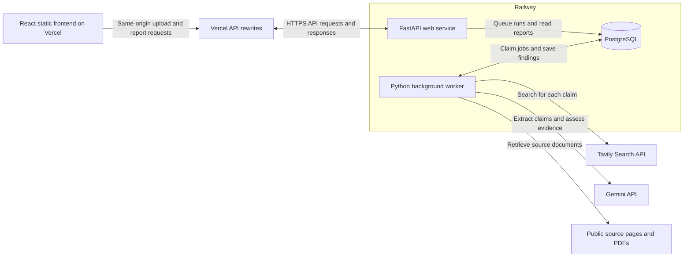

# Fact-Checking Web App Architecture

## System Overview

The app accepts a PDF and produces a report with one entry per factual claim. A React frontend handles upload, progress, and results. A FastAPI backend accepts the file and serves the report. A separate Python worker extracts claims, searches the live web, and checks the evidence. PostgreSQL stores pending work and report data so an upload can continue processing after the browser closes or a service restarts.

## Components

| Component | Responsibility |
| --- | --- |
| **React frontend** | Collect one PDF per run. Show upload errors, processing progress, and the report in document order. Each result shows the original wording, page, verdict, explanation, correction when available, and source links. |
| **FastAPI backend** | Serve the built frontend and API on the same origin. Check upload size and file type, create a run, and authorize access to its progress and results. Return once the job and file are durably stored. [FastAPI file uploads](https://fastapi.tiangolo.com/tutorial/request-files/) |
| **Python worker** | Parse the PDF, extract and validate claims, search for evidence, apply the verdict rules, and write progress and findings. PDF parsing runs with resource and time limits. |
| **PostgreSQL** | Keep the job queue, temporary PDF bytes, claims, evidence, and report results in one datastore. Transactions keep the queue and its data in sync. |
| **Tavily Search API** | Selected source-discovery provider for Phase 6. The worker will fetch candidate pages and use their contents as evidence. |
| **Gemini API** | Generate structured claims and evidence assessments. Both use the same `GEMINI_API_KEY`, `GEMINI_MODEL`, and `generateContent` request pattern. The worker validates every claim, citation, correction, and verdict locally. [Gemini structured outputs](https://aistudio.google.com/docs/structured-output) · [Gemini 3.5 Flash-Lite](https://aistudio.google.com/docs/models/gemini-3.5-flash-lite) |
| **Railway** | Host the FastAPI service, separate persistent Python worker, and PostgreSQL in one project/environment using private database references. [Railway Dockerfiles](https://docs.railway.com/builds/dockerfiles) |
| **Vercel** | Host the public React assets and forward `/api/*` and `/healthz` to Railway through external routes. No model/search credentials are configured here. [Vercel external rewrites](https://vercel.com/docs/routing/rewrites) |

## Frontend Design Workflow

Google Stitch is the design tool for the desktop and mobile upload, progress, and report screens. The chosen designs guide the React components and styles in `frontend/src/`. Use the [design brief](problem%20statement.md#google-stitch-design-brief) for the screens and states to cover.

Vite builds the React components and assets. FastAPI serves them locally and as a Railway fallback. In the selected split-host production deployment, Vercel serves the static frontend and proxies same-origin API requests to Railway; the browser retains the same upload/progress/report contract. The browser and backend run independently of Stitch.

## Data Flow

### 1. Accept the PDF and Queue the Run

The browser sends the PDF to FastAPI as a multipart upload. FastAPI enforces the byte limit and checks the PDF signature, then writes the run and temporary upload in one transaction. It returns `202 Accepted` with a run ID and a report access token. The browser polls for progress every few seconds and stops when the run reaches a terminal state. A temporary polling error leaves the most recent progress and findings visible.

### 2. Extract and Validate Claims

The worker uses `pypdf` to extract text by page and sends bounded sections to Gemini. Each proposed claim includes a verbatim excerpt, its page number, the specific fact to check, and its qualifiers. This allows the app to verify each distinct assertion in a sentence that cites multiple figures. The worker checks each excerpt against the extracted page text, allowing for PDF whitespace differences, and deduplicates matches from overlapping sections. The Phase 9 pipeline saves extracted claims and deletes the staged PDF in one transaction. [pypdf text extraction](https://pypdf.readthedocs.io/en/latest/user/extract-text.html)

The worker checks the page limit before extracting claims and records any unreadable pages so the report reflects its coverage. A readable PDF with no checkable claims produces an empty result. A malformed, password-protected, oversized, or entirely image-only PDF produces an explanation of why the run could not proceed. The first release supports PDFs with selectable text.

### 3. Find and Check Evidence

1. Build a query from the claim’s subject, metric, and qualifiers, such as geography, population, unit, and time period. Each claim gets a live search. When an explicit publisher is recognized, target its domain on the first pass. For weak evidence, broaden the follow-up around the underlying fact without the disputed value.
2. Fetch relevant public HTML pages or PDFs from the search results. Prioritize original reports, official data, and other primary sources. Record the source title, final URL, retrieval time, and the passage or table entry used. Capture the publication date and reporting period when the source identifies them.
3. Send the claim and retrieved passages to the model. It returns an assessment, the IDs of supporting evidence, and a proposed correction when the evidence establishes one. The worker checks those IDs against the passages it supplied for that claim. For numeric corrections, it checks the value, unit, and period against the cited passage when they can be parsed reliably. It publishes a correction only when the supplied evidence supports it, and builds links from the stored URLs.

For a historical claim, compare it against the named period. For a statistic presented as current, use the latest applicable release. Keep percentages distinct from percentage-point changes and align the definitions and units before comparing values.

### 4. Save the Verdict and Publish the Report

| Evidence outcome | Report result |
| --- | --- |
| Retrieved evidence supports the claim, including its date and scope. | **Verified**, with the supporting source. |
| Evidence identifies an outdated current figure or a wrong detail about a real metric or event. | **Inaccurate**, with the corrected fact and period when available. |
| Credible evidence refutes the premise, or a completed search finds no credible support after the follow-up. | **False**, with an explanation of whether the evidence contradicted the claim or the search found no support. Cite any source used to establish a contradiction. |
| A provider fails, material evidence is inaccessible, or the available sources leave a conflict unresolved. | Show the check as incomplete with a brief reason. Its verdict field stays empty. |

The worker saves each result and its evidence together. The frontend displays completed findings as they become available. The worker derives the final run state from the saved checks and page coverage, including when it resumes after a restart. If any pages or claims could not be checked, the report shows the coverage gap alongside the findings that are available.

## API and Data Model

| Endpoint | Contract |
| --- | --- |
| `POST /api/runs` | Accepts one PDF. Returns `202` with `run_id` and `access_token`. Rejects invalid uploads and returns `429` when the upload limit is reached. |
| `GET /api/runs/{run_id}` | Requires the run’s bearer token. Returns the run state and stage, claim progress, coverage gaps, and any results already saved. Responses use `Cache-Control: no-store`. |
| `GET /healthz` | Returns process liveness only (`{"status":"ok"}`); database/schema readiness and worker/provider health require separate checks. |

| Table | Key fields and relationships |
| --- | --- |
| `runs` | Run ID, access token hash, state, processing stage, page coverage, timestamps, processing deadline, report expiry, retry count, next attempt time, and worker lease. This table also serves as the job queue. |
| `uploads` | One row per run while extraction is pending. Holds the bounded PDF payload and its expiry. |
| `claims` | One row per factual assertion, keyed by run and sequence number. Holds the original excerpt, page, check target, and the qualifiers that guide search. |
| `claim_checks` | One row per claim. Holds processing status, optional verdict, explanation, optional correction, search attempts, and last check time. |
| `evidence` | Multiple rows per claim check. Holds the source URL, title, excerpt, publication date or period when known, retrieval time, and whether the excerpt supports, contradicts, or corrects the claim. |

The database uses foreign keys from uploads and claims to the run, from checks to claims, and from evidence to checks. Run states are `queued`, `running`, `completed`, `completed_with_gaps`, and `failed`. A run can complete with zero claims if the readable PDF contains no verifiable statements. `completed_with_gaps` covers unreadable pages or unfinished checks after extraction. `failed` covers errors that prevent extraction from producing a report.

## Reliability, Access, and Retention

- **Worker recovery.** Reserve a run with a short transaction using `FOR UPDATE SKIP LOCKED` and attach an expiring lease. The worker renews its lease while processing. Once a lease expires, another worker can resume from the last committed stage and skip completed checks. Writes must match the current lease so a stalled worker cannot overwrite newer results. External calls run outside database transactions. [PostgreSQL locking clauses](https://www.postgresql.org/docs/current/sql-select.html#SQL-FOR-UPDATE-SHARE)
- **Retries and usage limits.** Retry transient provider failures with bounded backoff. Cap concurrent runs and searches, and record work limits and attempts so a restart respects the same limits. If a run reaches its processing deadline, mark its unfinished work incomplete and keep any saved findings visible. If the deadline expires before extraction, close the run with an error.
- **Report access.** Use an unguessable, per-run token so reviewers can use the app without creating accounts. The browser keeps the token in session storage for refreshes in the same tab. PostgreSQL stores its hash. Keep tokens out of URLs and logs.
- **Uploaded and retrieved content.** Treat PDF text and web content as data. The worker controls search and retrieval, and the model receives only the text needed for the current task. Fetch public HTTP(S) URLs with limits on redirects, response sizes, and time, and enforce public-address checks at connection time and on redirects. Render excerpts as text in the browser.
- **Data lifetime.** Remove the live copy of the PDF after claim extraction commits or the run reaches a terminal extraction failure. A worker cleanup pass closes expired jobs and deletes expired reports and their child records. Start with configurable defaults of 10 MiB and 30 pages per PDF and 24 hours of report access after a run finishes. Show these limits in the upload interface. Hosting backups follow the database’s separate retention settings.

## Deployment and Review

The original plan specified Render. On November 23, 2026, the user selected Railway for backend services and Vercel for the frontend; no Render-versus-Railway decision remains open. Deploy API and worker from the same reviewed source with the root multi-stage `Dockerfile`. It builds React and includes `frontend/dist` for FastAPI. Apply `deploy/railway-api.settings.json` and `deploy/railway-worker.settings.json` through `scripts/configure_railway.py`, retaining repository-root build context. The hosted API rejects legacy `railway.json`/`railway.toml` config paths; this script uses the current authenticated CLI service-update API. Both use `python -m backend.migrate` as the pre-deploy gate. The migration runner applies 001–003 with a checksum ledger and advisory lock, and refuses an untracked pre-existing schema. [Railway pre-deploy commands](https://docs.railway.com/deployments/pre-deploy-command)

Railway API and worker reference PostgreSQL through private networking in the same region/environment. Configure `DATABASE_URL` on both; put `GEMINI_API_KEY` and `TAVILY_API_KEY` only on the worker. The worker has one replica and no public endpoint. API binds `0.0.0.0:$PORT` and exposes `/healthz`. Health success alone does not prove that migrations, providers, or the worker work.

Vercel builds the static frontend at repository root using `vercel.json`. `scripts/build-vercel.mjs` emits Build Output API static files and external routes from the public `RAILWAY_API_ORIGIN` build variable. Only `/api/*` and `/healthz` forward to Railway; API responses use no-store caching. This preserves session-storage bearer access without CORS or Vercel Functions. Upload size and proxy behavior still require verification on the actual hosted route. [Vercel Build Output API](https://vercel.com/docs/build-output-api)

See the Phase 11 section of README for build/start commands, fresh-database migrations, variables, and release checks. Account access, project selection, available credits/plans, and production provider quota must be confirmed before declaring deployment complete. Record only observed public URLs and actual checks in `docs/evals.md`.

Log run IDs, processing stages, durations, and provider error codes. Track queue age and worker activity so a stuck run can be distinguished from a slow search. Keep document contents, search queries, and report access tokens out of logs.

Before submission, run the deployed app against a PDF with a supported claim, an outdated statistic, a correctly dated historical statement, and a fabricated claim. Open the evidence behind each result and confirm that the correction matches the relevant scope and period. Simulate a search outage and a worker restart to check that incomplete work is reported accurately and saved findings survive. Use the resulting upload-to-report flow for the 30-second demo.

## Phases 6–7 implementation boundary

`processing/search.py` uses Tavily with distinct empty-success and failure outcomes, exposing initial and follow-up query construction. Follow-up is invoked by orchestration when evidence is weak; it does not infer weakness from a search snippet. `processing/retrieval.py` resolves each source hostname in a time-limited subprocess, rejects nonpublic answers, and pins the validated address for the connection while preserving TLS hostname verification. Redirects repeat these checks. Streaming byte limits apply before parsing. Source PDFs reuse the isolated parser and preserve their metadata title. Passage selection uses word overlap; source dates/periods remain separate from the claim qualifiers. The Phase 9 pipeline invokes these modules and persists attempts, retrieved passages, findings, and material-source failures.

## Phases 8–9 implementation

`processing/assessment.py` requests an assessment schema through Gemini `generateContent`, sharing the extraction key and model and validates IDs, source-quoted corrections, numeric value/unit/period, and historical scope locally. `SearchContext` is supplied by orchestration, never by the model. An interrupted search or material retrieval failure takes precedence over a proposed verdict. False from lack of support requires two completed searches.

`processing/pipeline.py` offloads synchronous parsing and provider calls to threads so the worker can renew its lease. It calls the configured search adapter through the existing `SearchResult` interface. `pipeline_store.py` fences every mutation with a row lock and a lease check against the database clock. Extraction and upload deletion form one transaction; each finding and its evidence form another. Composite primary keys identify claims and evidence within a run. Resume reads pending claims rather than repeating committed extraction or findings.

Migration `003_findings.sql` adds claim/check/evidence tables, persistent attempt counts, a deadline, report expiry, and coverage gaps. Search calls are reserved before dispatch, so a crash cannot reset their budget. Assessment calls have a separate durable cap of four per claim. HTTP operations are outside database transactions. The report reader uses a repeatable-read snapshot after token validation and exposes only validated evidence citations.

A ten-minute default budget includes queue time. Cleanup only closes expired/exhausted jobs with no live owner, preserves saved findings, deletes terminal uploads, and cascades expired report rows. The API independently denies expired reports. Single-worker concurrency is one run with sequential claims; multiple workers compete through the existing leased queue. System-wide concurrency is controlled by the deployed worker count.

## Local Gemini assessment verification

Extraction and assessment share the configured Gemini key/model and the existing JSON `generateContent` pattern. Assessment uses a 2,048-token cap and the same blocked/incomplete response handling, while its HTTP timeout and stable error codes remain unchanged. OpenAI and separate assessment-model settings have been removed. Tavily remains the search provider.

Local live verification revealed inaccessible mirrored and secondary pages. Provider-neutral `site:` hints are translated to Tavily `include_domains` parameters, rather than passed as literal query text. Source discovery now targets an explicitly recognized publisher first (including Amazon investor relations) and broadens its weak-evidence follow-up. Retrieval errors still prevent a verdict; no failed material source is ignored. Relative periods such as "latest completed calendar year" use current-figure rules; a named historical year still uses dated-period checks. The live test uses a synthetic public-data PDF and re-fetches cited passages after reading the saved report.

Numeric passage ranking includes source years and amounts along with metric terms. Equivalent calendar-year labels normalize to the year, while fiscal-year labels and differing years remain distinct. These local fixes preserve the model-independent citation, correction, historical-period, and incomplete-check guards.

## Phase 11 hosted result and source-address recovery

The selected Railway/Vercel deployment is live; exact URLs, deployment IDs, and public checks are in `docs/evals.md`. The source reader now prefers IPv4 and attempts alternate already-validated addresses after connection/request transport failures. Each attempt has at most three seconds for connection establishment and all attempts/redirects share the existing 15-second fetch deadline. Every DNS answer must still be public, redirects revalidate, TLS verifies the original hostname, and HTTP failures remain material failures. Railway defaults to disabled outbound IPv6; no new outbound/private-network access setting was needed. The deployment rerun reached a Verified NASA report after this change, while earlier incomplete runs remain unchanged. [Railway outbound networking](https://docs.railway.com/networking/outbound-networking)

The production Vercel alias is accessible without authentication; the unique deployment URL retains the platform's default deployment protection. No bypass secret was created for public checks. The fresh-browser check is pending the user's action because computer use was disabled. Public large-file transport timeouts remain an unresolved limitation, separate from the passing small-PDF workflow.
